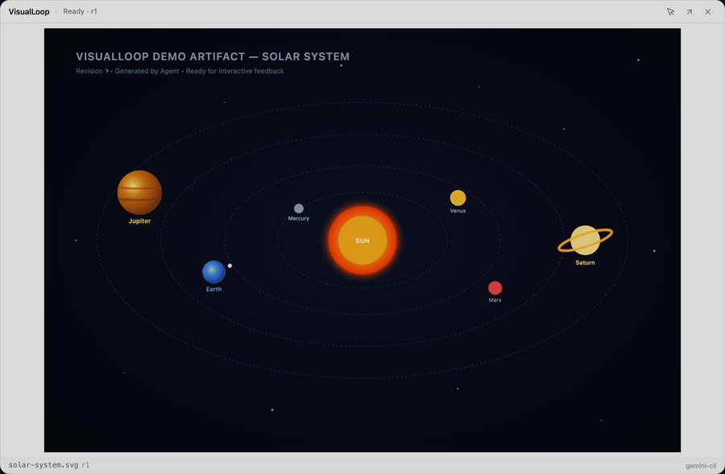
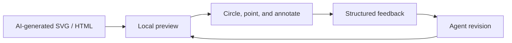

<div align="center">

# VisualLoop

### See it. Circle it. Fix it.

**Visual feedback for AI-generated interfaces.**  
Preview an artifact, mark exactly what needs to change, and send contextual feedback back to an agent.

[](https://github.com/JameMy0001/visualloop/actions/workflows/ci.yml)
[](LICENSE)
[](#project-status)

[Getting started](#getting-started) · [How it works](#how-it-works) · [Architecture](#architecture) · [Contributing](#contributing)

</div>

---

VisualLoop is an open-source, local-first desktop companion for reviewing visual work produced by AI coding tools. Instead of explaining a UI problem in a long chat message, you can point to the area in a floating preview, add a short instruction, and submit structured feedback.

The project currently targets **SVG and HTML artifacts**, with an experimental **Gemini API-powered revision workflow**. Other agent integrations are under development.

<div align="center">
  
</div>

## Why VisualLoop?

| Without VisualLoop | With VisualLoop |
| --- | --- |
| Describe positions and visual defects in text | Mark the exact region in a preview |
| Switch between the agent and a separate browser | Keep a compact, always-on-top preview nearby |
| Lose the context of which revision is being reviewed | Attach feedback to an artifact and revision |
| Pass around informal screenshots | Produce structured annotations and capture data |

VisualLoop focuses on the **review and feedback layer**. Your AI model remains responsible for generating and modifying the source code.

## How it works



1. **Publish** an SVG or HTML artifact through the local service.
2. **Preview** it in the floating mini window; expand to review the details.
3. **Annotate** regions with shapes and written instructions.
4. **Submit** feedback associated with the current session, artifact, and revision.
5. **Review** the next revision when the connected runner publishes an update.

> Automatic source-code changes require a configured agent runner. The current Gemini integration calls the **Gemini API**; it does not inject messages into an existing Gemini CLI conversation.

## What is implemented

| Capability | Current scope |
| --- | --- |
| Floating desktop preview | Tauri 2 mini / expanded windows; native window controls |
| Visual annotation | Circle, rectangle, arrow, and freehand markup |
| Artifact preview | SVG and HTML via the local service |
| Feedback transport | Fastify API, WebSocket events, revision metadata, persisted feedback |
| Gemini-powered revisions | Experimental runner using `GEMINI_API_KEY` and a source file |
| Claude Code / Codex | Adapter interfaces exist; automated delivery is not yet implemented |

## Getting started

### Prerequisites

- **Node.js 22** and **pnpm** (this repository pins `pnpm@12.3.4`)
- **Rust stable** and the [Tauri 2 prerequisites](https://v2.tauri.app/start/prerequisites/) for your operating system to run the native window
- A **Gemini API key** only if you want experimental model-assisted code revisions

### 1. Install and build

```bash
git clone https://github.com/JameMy0001/visualloop.git
cd visualloop
pnpm install
pnpm build
```

### 2. Run the desktop development stack

Run the unified launcher to start both the background core service and the desktop interface:

```bash
pnpm start
```

For browser-only testing without native Tauri windowing, run `pnpm start --web` (or `pnpm dev:web`).

You can also run the services in separate terminals:
- **Terminal A (Core Server):** `pnpm --filter @visualloop/core-server start`
- **Terminal B (Desktop Window):** `pnpm dev`

### 3. Try the experimental Gemini runner

With the local service and desktop app running, configure `GEMINI_API_KEY` in your shell or secrets manager. For example, in Bash/Zsh:

```bash
export GEMINI_API_KEY="your-api-key"
pnpm agent:gemini examples/solar-system.svg
```

This runner registers a session, publishes the selected file, polls for feedback, and requests a revised file from the Gemini API. The runner safely writes changes with automatic versioned backups (`.visualloop_backups/`) and rollback on validation failure. Content passed to Gemini is sent to Google's API and may incur usage charges.

## Development and verification

```bash
pnpm test                 # Unit and integration tests
pnpm typecheck            # Build and TypeScript validation
pnpm demo:golden-path     # Scripted feedback / revision smoke test
```

The scripted demo verifies local session, feedback, file mutation, and revision plumbing. It **does not** prove that a live Gemini model edited the file or that the desktop GUI completed an end-to-end review. GitHub Actions currently checks builds, tests, typechecking, and Rust compilation on **macOS and Ubuntu**.

## Architecture

```text
apps/desktop/              Tauri 2 + React review interface
packages/core-server/     Local API, events, and persisted state
packages/preview-engine/  Artifact loading and rendering utilities
packages/annotation-engine/ Coordinate mapping and annotation capture
packages/protocol/        Shared types and validation
packages/agent-sdk/       Adapter contracts
adapters/gemini-cli/       Experimental Gemini API-backed runner
adapters/claude-code/      Integration scaffold
adapters/codex/            Integration scaffold
skills/visualloop/        Agent skill instructions
```

VisualLoop is designed to remain **local-first**. The application exchanges preview and feedback state with a service on your machine. **Model-assisted revisions are not offline:** the experimental Gemini runner sends source code and feedback to the configured external API.

## Project status

**Developer Preview — v0.1.0 (source build).** The codebase has passing GitHub Actions checks, but there are known release blockers before we can call it a public beta:

- The one-command launcher and desktop packaging need final integration and verification.
- HTML screenshot capture and the headless screenshot worker need fidelity testing; the worker currently produces valid PNG files containing solid-color placeholders rather than the rendered artifact.
- The SVG/HTML preview security boundary and local API authentication need further hardening.
- End-to-end testing with a real desktop window and a live Gemini model must be demonstrated and documented.

These limitations are tracked in the project release-readiness review. Please use caution with untrusted artifacts and avoid reviewing sensitive source files until the security model has been verified.

## Contributing

Contributions, bug reports, and design feedback are welcome. See [CONTRIBUTING.md](CONTRIBUTING.md), open an [issue](https://github.com/JameMy0001/visualloop/issues), or propose a focused pull request.

Suggested areas: browser capture fidelity, secure preview isolation, agent adapters, accessibility, native window behavior, and release packaging.

## License

VisualLoop is released under the [MIT License](LICENSE).

---

<div align="center">
  <sub>Built for clearer feedback between people and coding agents.</sub>
</div>
