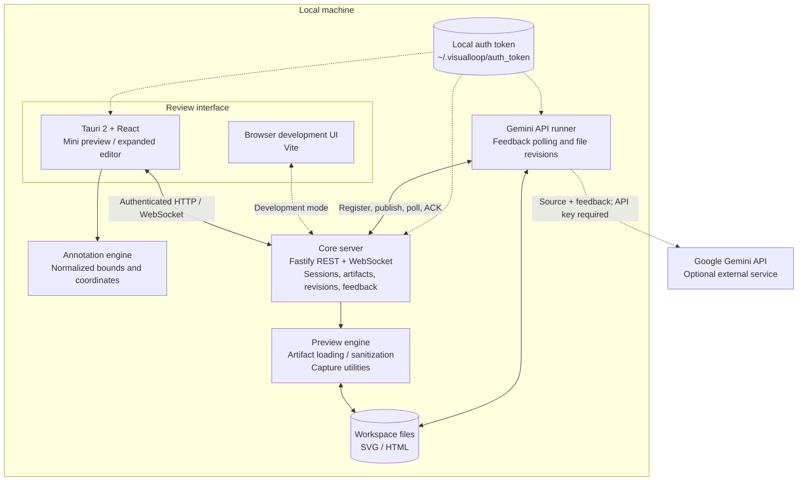
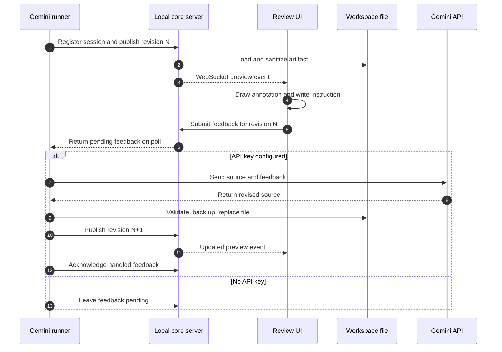

<div align="center">

# VisualLoop

### See it. Circle it. Fix it.

**A local-first visual feedback layer for AI-generated interfaces.**

Review a UI in a floating preview, mark the exact region that needs work, and send structured, revision-aware feedback to an AI coding workflow.

[](https://github.com/JameMy0001/visualloop/actions/workflows/ci.yml)
[](LICENSE)
[](#project-maturity)

[Overview](#overview) · [Demo](#demo) · [Architecture](#system-architecture) · [Getting started](#getting-started) · [Technical details](#technical-details) · [Contributing](#contributing)

</div>

---

## Overview

When an AI coding agent produces a visual interface, reviewing the result often means taking screenshots, switching windows, and trying to explain exactly which element needs changing. The feedback is easy to lose, especially across multiple revisions.

**VisualLoop makes visual review a first-class part of the agent workflow.** It provides a compact desktop companion where a reviewer can inspect an SVG or HTML artifact, draw an annotation on the relevant area, add an instruction, and submit feedback tied to the artifact and revision.

VisualLoop is **not another code-generation model**. It is the review, context, and feedback layer between a person and a code-modifying agent. The currently implemented model-powered path uses Google's Gemini API through a separate local runner; it does **not** write messages into an already-running Gemini CLI chat session.

### Who is it for?

- **AI-assisted developers** who want to review generated interfaces without describing every visual issue in prose.
- **Designers and reviewers** who want to communicate location-specific changes to an engineering or agent workflow.
- **Open-source contributors and tooling teams** exploring human-in-the-loop feedback, local-first developer utilities, and agent integrations.

### The idea in one example

Instead of saying *“make the sun in the solar-system mockup bigger, but leave the orbit alone”*, mark the sun in the preview and attach the instruction **“Increase this circle by 25%; keep the orbit unchanged.”** VisualLoop associates the annotation with a specific artifact, viewport, and revision so a connected runner can act on that context.

## Demo

<div align="center">
  
  <br />
  <sub>Scripted UI walkthrough. This GIF is not evidence of a native Tauri + live Gemini model end-to-end run; see <a href="#verification-and-testing">Verification and testing</a>.</sub>
</div>

### What the experience is designed to look like

1. **Publish:** A local runner registers a session and publishes an SVG or HTML artifact.
2. **Preview:** The artifact appears in a compact, floating preview; expand it for closer review.
3. **Annotate:** Mark a region and attach a written change request.
4. **Submit:** VisualLoop records a structured feedback item with annotation coordinates and revision metadata.
5. **Revise:** A configured runner consumes the feedback, updates the file, and publishes a subsequent revision.
6. **Compare and iterate:** Review the updated artifact and repeat if necessary.

The interface supports the human review steps. Automatic revision requires a connected runner and, for the current Gemini integration, a valid API key.

## Why this approach?

| Typical AI UI review | With VisualLoop |
| --- | --- |
| “The thing near the top-right looks wrong.” | Annotate the exact region on the current preview. |
| Feedback lives in screenshots and chat messages. | Feedback is represented as structured annotations and instructions. |
| It is unclear which version a comment applies to. | Feedback references a session, artifact, and revision. |
| Reviewing means switching to a separate browser or image viewer. | A Tauri desktop companion offers mini and expanded views. |
| Integrations are tightly coupled to one UI. | A local server and adapter contracts separate review from model execution. |

## System architecture

VisualLoop is a **local-first TypeScript monorepo with a Tauri 2 desktop shell**. The UI, API, preview utilities, annotation geometry, and agent adapter have separate responsibilities.

GitHub renders the Mermaid diagrams below directly from this README. The diagrams document the intended component boundaries and the implemented Gemini API runner—not a claim that every proposed third-party adapter is operational.

### Component diagram



**Key design decisions:** The desktop UI owns interaction and annotation; the core service owns session/revision state and feedback transport; the preview engine handles artifact loading and sanitization; a separate runner is responsible for model calls and source-file changes. Local-first **does not mean offline** when the Gemini API integration is enabled.

### Feedback-to-revision sequence



The sequence describes the runner-driven flow. Automated test coverage for the protocol does not by itself prove a real person operated a native desktop window or that Google Gemini processed a request.

## Current capabilities

| Area | Implemented today | Important boundary |
| --- | --- | --- |
| Desktop review | Tauri 2 + React UI with compact and expanded modes, desktop window controls, and preview state | Native interaction still needs hands-on release qualification. |
| Visual annotations | Markup shapes, instructions, viewport-aware normalized geometry | Coordinate fidelity should be evaluated against real preview content. |
| Artifacts | Local SVG and HTML artifact loading/preview | Headless capture does not fully reproduce arbitrary browser-rendered content. |
| Feedback and events | Fastify API, feedback queue, session/revision records, WebSocket updates | Requires the local core service. |
| Gemini revisions | Optional Gemini API runner reads feedback, edits a local file, and republishes it | Needs `GEMINI_API_KEY`; **not** direct injection into an existing Gemini CLI session. |
| File safeguards | Workspace checks, validation for generated SVG structure, staged replacement, versioned backups | Validation is not a complete XML/HTML security or semantic correctness guarantee. |
| Other agent adapters | Agent SDK contracts and Claude Code/Codex scaffolding | Automated Claude Code/Codex revision integration is not complete. |
| Releases | CI and a cross-platform draft-release workflow are configured | No verified publicly distributed installer or stable release yet. |

## Getting started

**This is a source-build developer preview**, not a polished one-click installation.

### Prerequisites

- **Node.js 22** and **pnpm 12.3.4** (the version declared by the workspace).
- **Rust stable / Cargo** and the [Tauri 2 prerequisites](https://v2.tauri.app/start/prerequisites/) for your operating system when using the native desktop app.
- Git.
- **Optional:** a Gemini API key for model-generated file revisions.

### 1. Clone and build

```bash
git clone https://github.com/JameMy0001/visualloop.git
cd visualloop
pnpm install
pnpm build
```

### 2. Start VisualLoop

```bash
pnpm start
```

The unified launcher starts the local core server (default: `http://127.0.0.1:4178`) and the Tauri desktop development app. It configures a local authentication token for the cooperating processes.

For browser-only development without a native Tauri window:

```bash
pnpm start --web
```

To run individual development services instead:

```bash
# Terminal A: core server
pnpm --filter @visualloop/core-server start

# Terminal B: Tauri desktop development window
pnpm dev
```

### 3. Try a local artifact with Gemini (optional)

In a separate terminal, from the repository root:

```bash
# Set the key in your own shell or secrets manager; do not commit it
export GEMINI_API_KEY="your-api-key"

# Start an agent runner against the included example SVG
pnpm agent:gemini examples/solar-system.svg
```

Open the VisualLoop desktop UI, review the published artifact, annotate it, and submit feedback. With the key configured, the runner requests an updated source file from the Gemini API and publishes the next revision after applying its file-safety checks.

Without `GEMINI_API_KEY`, the runner can format feedback for review, but **does not automatically edit the file**; feedback is kept pending. Model use can incur charges and sends relevant source/feedback content to Google's service.

> **Important:** The runner can change the target source file. Use Git, review the generated diff, and work on a disposable example or a branch until you are comfortable with the workflow.

## Technical details

### Repository map

```text
apps/desktop/               Tauri 2 + React review interface
  src/                      Mini preview, expanded editor, UI state and clients
  src-tauri/                Rust window commands and native configuration

packages/core-server/       Fastify API, WebSocket events, session/revision store
packages/preview-engine/    Artifact loader, SVG sanitization, capture helpers
packages/annotation-engine/ Annotation operations and coordinate mapping
packages/protocol/          Shared request/event schemas and TypeScript types
packages/agent-sdk/         Agent adapter interfaces

adapters/gemini-cli/        Gemini API-backed adapter and revision safeguards
adapters/claude-code/       Adapter scaffold
adapters/codex/             Adapter scaffold

scripts/                    Launcher, Gemini runner, demonstrations, E2E checks
examples/                   Example artifacts
docs/                       Release-readiness notes and demonstration assets
.github/workflows/          CI and draft-release automation
```

### Protocol and revision model

- A **session** associates an agent/runner with a workspace.
- An **artifact** identifies a reviewable SVG or HTML source.
- A **revision** identifies the specific published version being reviewed.
- A **feedback item** includes instructions and normalized annotation bounds associated with that session, artifact, and revision.
- The **core server** queues feedback and broadcasts events; a **runner** polls for pending feedback and acknowledges it after processing.

This separation enables different agents to implement their own adapters without embedding model-specific behavior into the desktop UI.

### Local security and data flow

- The core server binds to loopback by default and requires a local token by default for protected API/WebSocket access. Tokens are stored in `~/.visualloop/auth_token`; do not share or commit them.
- The origin-checking and preview-sanitization layers reduce exposure to untrusted artifacts. HTML is previewed in a sandboxed iframe; this is a security boundary to test, not a guarantee that arbitrary untrusted content is harmless.
- The Gemini runner includes workspace path checks, SVG structure checks, backups, and staged file replacement. Keep your own version control as an additional recovery mechanism.
- Local preview and feedback transport run on your machine. **When Gemini is enabled, source code, feedback, and optionally an annotated image may leave your machine** through the API request.

See [SECURITY.md](SECURITY.md) for the security model and vulnerability reporting instructions.

## Verification and testing

The CI workflow runs on **macOS and Ubuntu** and includes workspace builds, automated tests, TypeScript checks, Rust `cargo check`, a scripted feedback loop, the Gemini pipeline script, and a core-server CLI smoke test.

```bash
pnpm test                 # Unit and integration suites
pnpm typecheck            # Build and TypeScript type checks
pnpm demo:golden-path     # Scripted local feedback/revision plumbing test
pnpm test:gemini-e2e      # Pipeline test (offline fallback if no Gemini key)
cd apps/desktop/src-tauri && cargo check
```

**What passing CI means—and what it does not:**

- The [CI workflow](https://github.com/JameMy0001/visualloop/actions/workflows/ci.yml) has passed on both supported CI runners for the recent source commits.
- `pnpm test:gemini-e2e` **uses a simulated model response when `GEMINI_API_KEY` is absent**. A green CI step is not proof of a live Google Gemini API call.
- Scripted pipeline tests do **not** replace hands-on native desktop E2E, pixel comparisons against real browser rendering, or clean installation of packaged binaries.
- The [release workflow](.github/workflows/release.yml) defines draft/prerelease build automation; successful, installable distributions must be verified separately.

For tracked qualification details, see [Release readiness](docs/RELEASE_READINESS.md) and the [Changelog](CHANGELOG.md).

## Project maturity

**Developer Preview — v0.1.0 source tree.**

The architecture, local service, UI, annotation flow, Gemini runner, and automated verification are available for exploration and contribution. VisualLoop should **not** yet be represented as production-ready, a fully validated public beta, or a universally compatible desktop application.

Known work before a broad public-beta release includes:

1. **Native desktop E2E:** verify real user interaction, window behavior, review submission, and revision refresh on target platforms.
2. **Capture fidelity:** the headless SVG rasterizer implements a subset of SVG elements/commands; complex SVG, text styling, and browser-rendered HTML are not guaranteed pixel-faithful. Headless HTML capture requires a browser/WebView context.
3. **Live model evidence:** validate real Gemini API requests and nontrivial revisions with credentials provided securely, distinct from the offline simulation used by CI.
4. **Distribution:** produce, install, and smoke-test desktop packages per platform, with any required signing/notarization.
5. **Hardening:** continue negative security tests and review of generated source before file replacement.

**Platform notes:** macOS and Ubuntu are covered by source-build CI. The release configuration targets macOS (Intel/Apple Silicon), Linux (x86_64), and Windows (x86_64), but an OS appearing in the release matrix is **not** a claim that installers have shipped or been verified there.

## Contributing

VisualLoop is open source and welcomes bug reports, reproducible tests, documentation improvements, design feedback, and focused pull requests.

Start with [CONTRIBUTING.md](CONTRIBUTING.md), browse the [issues](https://github.com/JameMy0001/visualloop/issues), and include steps to reproduce plus platform/environment details when reporting a bug.

Useful areas for contributions include capture fidelity, native desktop behavior, accessibility, deeper agent adapters, security regression tests, and release packaging. Please disclose vulnerabilities privately using the instructions in [SECURITY.md](SECURITY.md).

## License

[MIT License](LICENSE). You can inspect, reuse, and contribute to the source under the terms of that license.

---

<div align="center">
  <sub>VisualLoop — make feedback about AI-generated interfaces visual, specific, and actionable.</sub>
</div>
